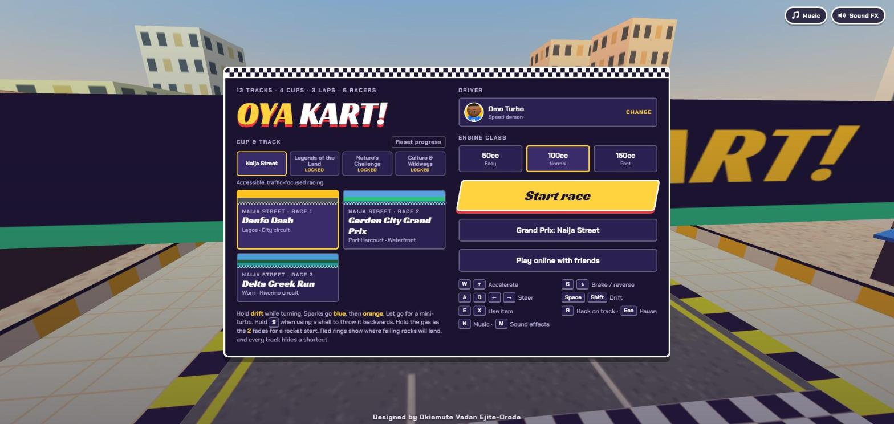
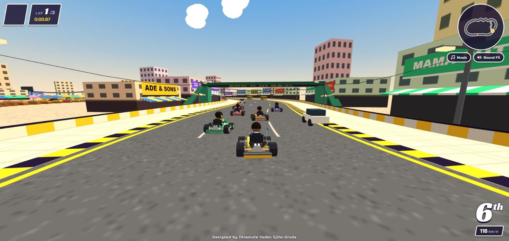
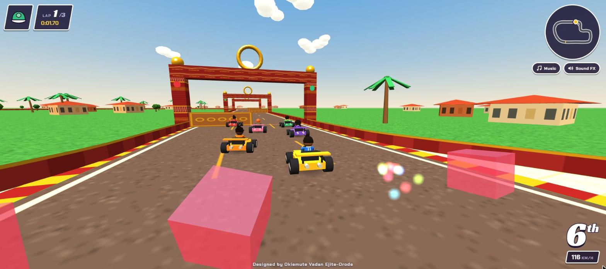
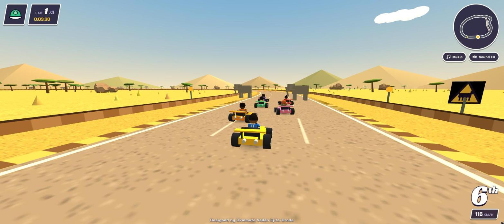
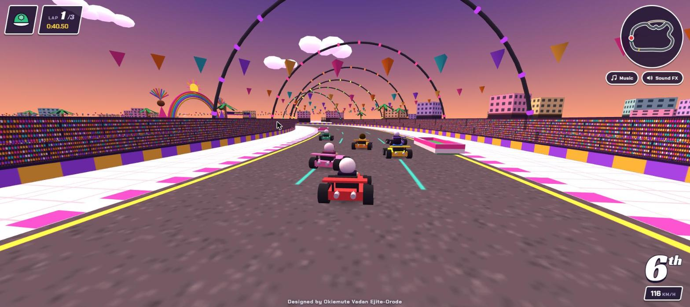
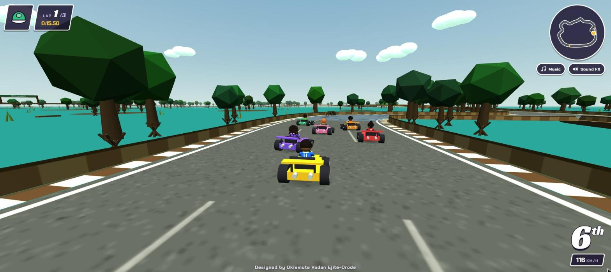

# OYA KART!

A 3D kart racer that runs in the browser. Race five computer rivals over three laps, or up to five friends online. Drift for mini-turbos, grab items and unlock every track.



| Danfo Dash | Bronze Kingdom |
|---|---|
|  |  |
| **Savannah Stampede** | **Carnival Chaos** |
|  |  |



## Tracks

13 tracks in four cups. Pick a cup on the title screen, then a track.

### Naija Street Cup

*Accessible, traffic-focused racing.*

| # | Track | Setting |
|---|-------|---------|
| 1 | Danfo Dash | Lagos streets, markets and a flyover over the lagoon. Yellow danfo buses drive laps in the outer lanes and spin you out if you hit them; parked cars, potholes and roadworks narrow the road. A service lane behind the market stalls is a shortcut, but it's narrow and has parked cars in it |
| 2 | Garden City Grand Prix | Port Harcourt: a tree-lined boulevard, a narrow bridge over a creek, then an industrial waterfront and a riverside run to the finish. The waterfront roads are wet and slippery (karts slide wide), puddles splash you, steam drifts across the road and slow tanker trucks do laps. A riverside service road is a shortcut, but it's narrow and wet all the way |
| 3 | Delta Creek Run | Warri: a riverside settlement, a raised causeway and a long bridge over the creek, tight bends through a riverside neighbourhood (with mud that bogs you down), then a bumpy plank jetty to the finish. Boats run up and down the channels and debris drifts on the water. A narrow plank boardwalk is a shortcut, with a jump over a broken section: hit the ramp fast or you drop into the water and start again on the boardwalk |

### Legends of the Land Cup

*Landmarks and technical turns.*

| # | Track | Setting |
|---|-------|---------|
| 4 | Zuma Rock Circuit | Abuja: a modern boulevard out of the city, then a climb past Zuma Rock through two tight hairpins, a tunnel through a rock outcrop and a fast run back down. Climbs slow you and descents let you run past your top speed. Rocks fall in two marked stretches (a red ring shows where), and loose gravel cuts your grip. A narrow, rough mountain pass cuts across the second hairpin |
| 5 | Bronze Kingdom | Benin City: a monumental gate, a ceremonial avenue of bronze sculptures, a courtyard district of tight corners between patterned walls, three timed gateways, and a plaza of turning bronze arms and sliding floor plates. Each gateway has two leaves that rise from the road in turn, so one half is always open: lamps go green, then flash amber before a leaf rises, then red. A narrow passage between courtyards cuts the last corner, with a tight exit just before the first gateway |
| 6 | Olumo Rock Rush | Abeokuta: from a town square, up round a great granite formation, through a natural rock arch and down three switchbacks hemmed in by boulders, then a stone-lined run home. The road edges are raised stone: clip them and you lose speed. Small stones fall in two marked stretches and gravel lines the outside of two hairpins. A lit cave through the rock formation cuts off the big climbing curve |

### Nature's Challenge Cup

*Elevation, grip changes and off-road racing.*

| # | Track | Setting |
|---|-------|---------|
| 7 | Plateau Peak Rally | Jos: a highland road that sweeps down into a rocky valley, then climbs three hairpins back to the plateau. Boulders roll across the road at marked crossings on a fixed cycle (lamps flash and a red line pulses first), gravel lines the outside of bends, and two chevron-marked ramps launch you: land pointing down the road or lose speed. A rough hillside cut skips the two sweeping bends and ends in a jump back onto the road |
| 8 | Savannah Stampede | Yankari: a broad dusty road onto the open savannah, gentle bends through rocky country, a bridge over a stream, and a fast dirt road home. The hardpack grips; the dirt stretches slide and throw up dust, so corners need a different touch. Elephants and giraffes cross at two signposted spots on a fixed cycle (lamps flash first; bumping one only slows you), rocks line the edges in the rocky section, and there's mud by the stream. A bumpy, loose trail across the scrub is a shortcut |
| 9 | Atlantic Coast Chase | Badagry: a paved coastal road curving beside the lagoon, a narrow wooden bridge over a creek, a sandy beachside stretch round a headland, and a fast paved run home. Paving grips; sand slides and slows you. Shallow water crosses the road at two marked spots (just a splash), and fishing nets, baskets and crates line the beach. A sandy route across the dunes cuts off the headland |

### Culture & Wildways Cup

*Environmental variety and advanced shortcuts.*

| # | Track | Setting |
|---|-------|---------|
| 10 | Sacred Grove Sprint | Osogbo: through a forest entrance, under a dense leafy canopy (falling leaves, shafts of light, a closer green haze), over a river bridge and into an open clearing lined with abstract sculptures, then back through the forest. Roots across the road edges jolt you and low branches overhang them. On the bridge, two wooden drawbridge halves (marked by jade lanterns) take turns to tip up, so one half is always open. A narrow woodland path twists through the clearing as a shortcut. The sculptures are fictional forms, set back from the road |
| 11 | Carnival Chaos | Calabar at festival time: under a rainbow festival arch, down a parade avenue between cheering crowds and bunting, sweeping bends round stages and giant drums, a decorated plaza with a chicane, and an illuminated boulevard under arches of colour-chasing lights. Festival boost zones are painted across the road: cross inside the glowing band (marked with floating music notes) for a boost. Slow parade floats do laps, foam inflatables bounce you off the edges, festival barriers make alternate lines, and confetti cannons fill the edges of your view. A backstage service lane with a narrow entrance skips the plaza |
| 12 | Palm Forest Rally | A tropical plantation: a broad access road, then red-earth tracks between long rows of palms, a narrow S-bend section, a muddy clearing with a small jump, and a straight home through the plantation. The tree-lined corridors are narrow, so clean driving beats raw speed. Logs and fallen fronds lie at some edges, small branches lie on the road, and the mud is slippery. A narrow maintenance lane through denser palms skips the S-bends |
| 13 | Mangrove Mayhem | The Niger Delta wetlands: a raised road over the water, down into a winding mangrove corridor, two narrow timber bridges either side of a tight bend, a run of slippery linked curves, and back up onto the raised road. Mud patches and slick bends cut your grip, and mangrove roots creep onto the outside of the turns, so line choice matters. Debris and canoes drift on the water. A short plank boardwalk across the shallows cuts the corridor's big bend |

Finish a track in the top 3 to unlock the next one. A top-3 finish on the last track of a cup opens the next cup. Progress is saved in your browser, and **Reset progress** on the title screen locks the tracks again and clears your trophies.

### Grand Prix

Once you've unlocked every track in a cup, **Grand Prix** on the title screen races them all in a row. Each race scores points by finishing place (10, 8, 6, 4, 2, 1); after the first race, your rivals line up in points order. There are no retries, so make every race count. The most points after the last race wins the cup, and a top-3 finish overall earns a gold, silver or bronze trophy, shown under the cup on the title screen. Ties go to whoever placed higher in the last race.

Each track has its own music and background sounds, generated live with the Web Audio API.

## Controls

| Key | Action |
|-----|--------|
| W / ↑ | Accelerate |
| S / ↓ | Brake / reverse |
| A D / ← → | Steer |
| Space / Shift | Drift (hold while turning, let go for a mini-turbo) |
| E / X | Use item (hold S to throw a shell backwards) |
| R | Put your kart back on the track |
| Esc / P | Pause |
| N | Music on/off |
| M | Sound effects on/off |

### On a phone

Hold your phone sideways. The kart accelerates by itself, ◀ ▶ steer on the left, and **Drift**, **Item** and **Brake** sit on the right, with a pause button at the top. On Android, tapping **Start race** switches to full screen and locks the phone to landscape. On iPhone, turn it sideways yourself (the game asks you to when it's held upright).

## Play online with friends

1. On the title screen choose **Play online with friends**, type your name and choose **Host a race**.
2. You get a 4-letter room code. Send it to your friends, or use **Copy invite link** (**Share invite link** on phones) so they land straight on the join screen.
3. Friends choose **Play online with friends**, type the code and choose **Join**.
4. Everyone picks a driver (each driver can only be taken once). The host picks the track and engine class, then starts the race.

Up to 6 people can race, and computer rivals fill the empty places. The host can only choose tracks they have unlocked. Online races don't pause: **Esc** opens a menu while your kart waits on the track. If a guest leaves mid-race, a computer rival takes over their kart. If the host leaves, the room closes.

### How it works

Players connect to each other directly in the browser (WebRTC), through [PeerJS](https://peerjs.com/). PeerJS's free public server only introduces the players to each other. If two networks can't connect directly (phone data, school or work Wi-Fi, some routers), a relay from [Metered](https://www.metered.ca/stun-turn) carries the traffic instead. The relay's passwords come from a small [Cloudflare Worker](worker/turn-credentials.js) (`TURN_CREDENTIALS_URL` in `index.html`), so the Metered key never appears in the game's code. The key is stored as the Worker's `METERED_API_KEY` secret, and the Worker only answers requests from the game's website. Apart from that Worker, there is no server to run, so online play works on GitHub Pages as it is.

Every player's computer drives their own kart, so steering never waits on the internet. Each kart's position goes out 20 times a second, and other people's karts glide between updates. The host's computer also drives the computer rivals and the moving hazards. Shells and bananas are announced when they're thrown, and the computer of the kart that gets hit decides the hit.

All messages pass through the host. The connection code (`peerTransport()` in `index.html`) is kept separate from the game, so it can be swapped for a WebSocket game server later without changing the race code.

## Run it locally

The game is a single `index.html` file. Three.js, PeerJS and the fonts load from public CDNs, so you need an internet connection.

Opening the file directly works, but serving it is closer to how it runs online:

```
python -m http.server 8000
```

Then open http://localhost:8000.

## Publish with GitHub Pages

1. Push this repository to GitHub.
2. In the repository, open **Settings → Pages**.
3. Under **Build and deployment**, choose **Deploy from a branch**, branch **main**, folder **/ (root)**, then save.
4. After a minute or two the game is live at `https://<your-username>.github.io/<repository-name>/`.

## Built with

- [Three.js](https://threejs.org/) r128 for the 3D graphics
- [PeerJS](https://peerjs.com/) 1.5.5 for online races
- Web Audio API for the music and sound effects
- Google Fonts: Racing Sans One and Chakra Petch
