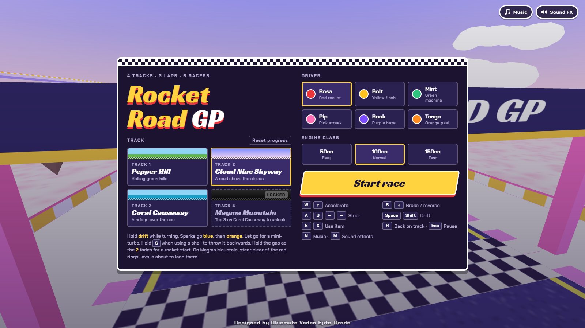
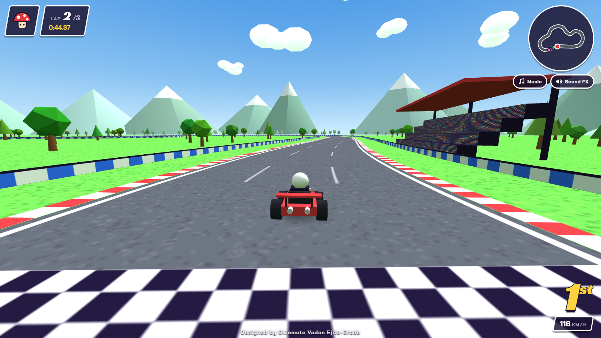
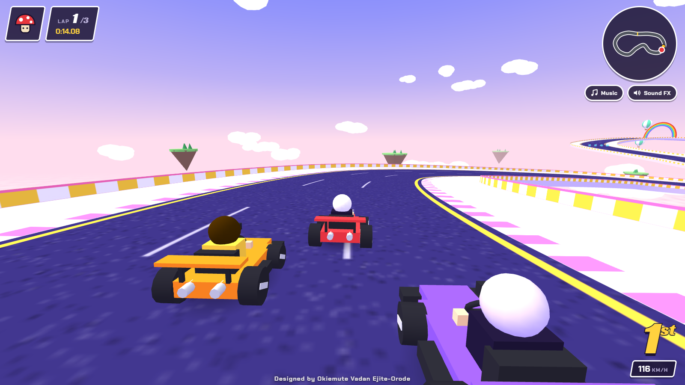
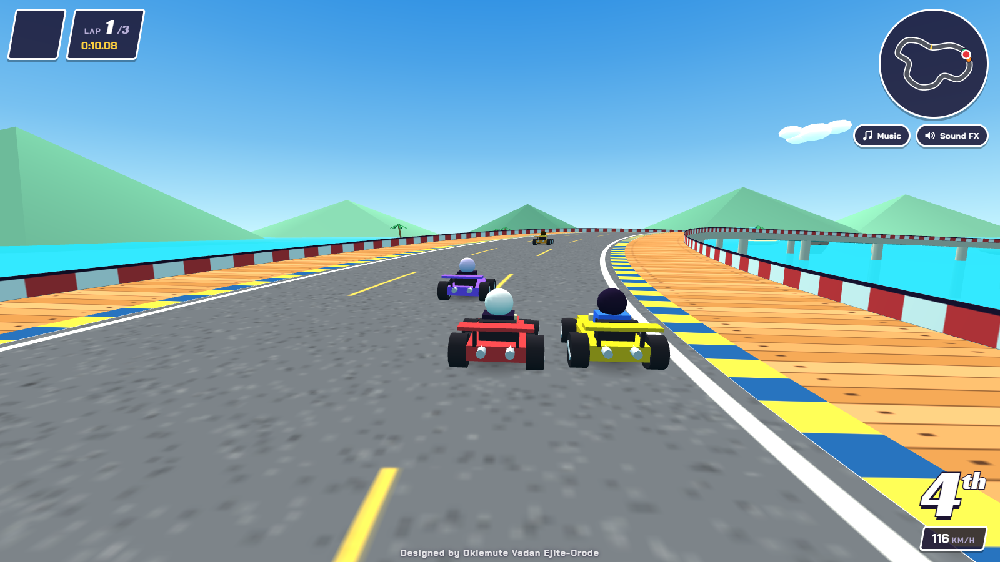
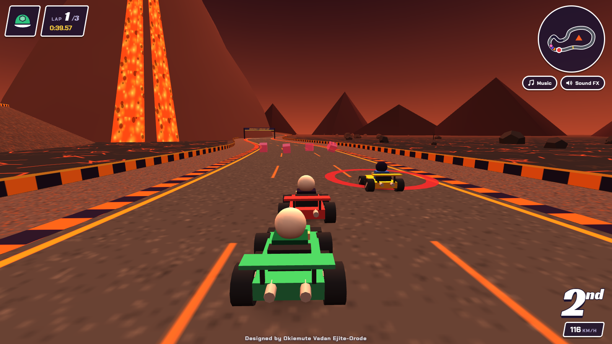
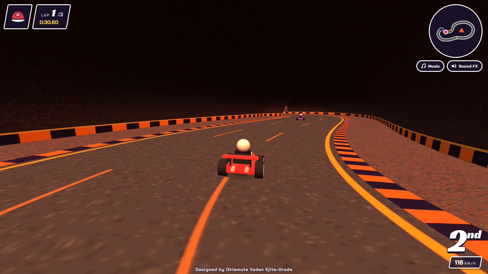
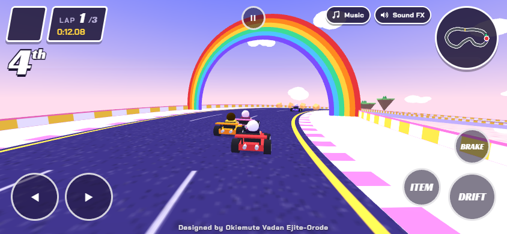

# OYA KART!

A 3D kart racer that runs in the browser. Race five computer rivals over three laps, or up to five friends online. Drift for mini-turbos, grab items and unlock every track.



| Pepper Hill | Cloud Nine Skyway |
|---|---|
|  |  |
| **Coral Causeway** | **Magma Mountain** |
|  |  |



## Tracks

| # | Track | Setting |
|---|-------|---------|
| 1 | Danfo Dash | Lagos streets, markets and a flyover over the lagoon. Yellow danfo buses drive laps in the outer lanes and spin you out if you hit them; parked cars, potholes and roadworks narrow the road. A service lane behind the market stalls is a shortcut, but it's narrow and has parked cars in it |
| 2 | Garden City Grand Prix | Port Harcourt: a tree-lined boulevard, a narrow bridge over a creek, then an industrial waterfront and a riverside run to the finish. The waterfront roads are wet and slippery (karts slide wide), puddles splash you, steam drifts across the road and slow tanker trucks do laps. A riverside service road is a shortcut, but it's narrow and wet all the way |
| 3 | Delta Creek Run | Warri: a riverside settlement, a raised causeway and a long bridge over the creek, tight bends through a riverside neighbourhood (with mud that bogs you down), then a bumpy plank jetty to the finish. Boats run up and down the channels and debris drifts on the water. A narrow plank boardwalk is a shortcut, with a jump over a broken section: hit the ramp fast or you drop into the water and start again on the boardwalk |
| 4 | Pepper Hill | Rolling green hills |
| 5 | Cloud Nine Skyway | A floating road above the clouds |
| 6 | Coral Causeway | A bridge over the sea |
| 7 | Magma Mountain | A tunnel and an erupting volcano that throws lava bombs |

Finish a track in the top 3 to unlock the next one. Progress is saved in your browser, and **Reset progress** on the title screen locks the tracks again.

Each track has its own music and background sounds, generated live with the Web Audio API.

## Controls

| Key | Action |
|-----|--------|
| W / ↑ | Accelerate |
| S / ↓ | Brake / reverse |
| A D / ← → | Steer |
| Space / Shift | Drift (hold while turning, let go for a mini-turbo) |
| E / X | Use item (hold S to throw a shell backwards) |
| R | Put your kart back on the track |
| Esc / P | Pause |
| N | Music on/off |
| M | Sound effects on/off |

### On a phone

Hold your phone sideways. The kart accelerates by itself, ◀ ▶ steer on the left, and **Drift**, **Item** and **Brake** sit on the right, with a pause button at the top. On Android, tapping **Start race** switches to full screen and locks the phone to landscape. On iPhone, turn it sideways yourself (the game asks you to when it's held upright).



## Play online with friends

1. On the title screen choose **Play online with friends**, type your name and choose **Host a race**.
2. You get a 4-letter room code. Send it to your friends, or use **Copy invite link** (**Share invite link** on phones) so they land straight on the join screen.
3. Friends choose **Play online with friends**, type the code and choose **Join**.
4. Everyone picks a driver (each driver can only be taken once). The host picks the track and engine class, then starts the race.

Up to 6 people can race, and computer rivals fill the empty places. The host can only choose tracks they have unlocked. Online races don't pause: **Esc** opens a menu while your kart waits on the track. If a guest leaves mid-race, a computer rival takes over their kart. If the host leaves, the room closes.

### How it works

Players connect to each other directly in the browser (WebRTC), through [PeerJS](https://peerjs.com/). PeerJS's free public server only introduces the players to each other. If two networks can't connect directly (phone data, school or work Wi-Fi, some routers), a relay from [Metered](https://www.metered.ca/stun-turn) carries the traffic instead. The relay's passwords come from a small [Cloudflare Worker](worker/turn-credentials.js) (`TURN_CREDENTIALS_URL` in `index.html`), so the Metered key never appears in the game's code. The key is stored as the Worker's `METERED_API_KEY` secret, and the Worker only answers requests from the game's website. Apart from that Worker, there is no server to run, so online play works on GitHub Pages as it is.

Every player's computer drives their own kart, so steering never waits on the internet. Each kart's position goes out 20 times a second, and other people's karts glide between updates. The host's computer also drives the computer rivals and the volcano. Shells and bananas are announced when they're thrown, and the computer of the kart that gets hit decides the hit.

All messages pass through the host. The connection code (`peerTransport()` in `index.html`) is kept separate from the game, so it can be swapped for a WebSocket game server later without changing the race code.

## Run it locally

The game is a single `index.html` file. Three.js, PeerJS and the fonts load from public CDNs, so you need an internet connection.

Opening the file directly works, but serving it is closer to how it runs online:

```
python -m http.server 8000
```

Then open http://localhost:8000.

## Publish with GitHub Pages

1. Push this repository to GitHub.
2. In the repository, open **Settings → Pages**.
3. Under **Build and deployment**, choose **Deploy from a branch**, branch **main**, folder **/ (root)**, then save.
4. After a minute or two the game is live at `https://<your-username>.github.io/<repository-name>/`.

## Built with

- [Three.js](https://threejs.org/) r128 for the 3D graphics
- [PeerJS](https://peerjs.com/) 1.5.5 for online races
- Web Audio API for the music and sound effects
- Google Fonts: Racing Sans One and Chakra Petch
